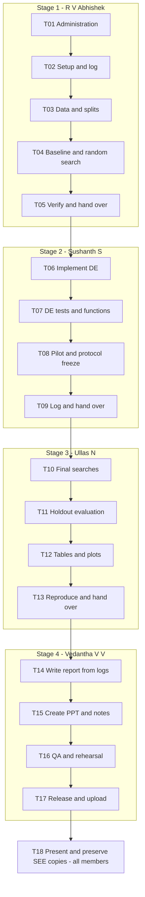

# Sequential implementation plan: Concrete Strength DE-SVR

Updated: 26 October 2026. Version 2.0 replaces the earlier parallel-work plan.

**Title:** Concrete Compressive Strength Prediction Using Differential Evolution–Optimized Support Vector Regression.

**Workflow:** Abhishek finishes → Sushanth finishes → Ullas finishes → Vedantha finishes the report and presentation. Only one member owns active project work at a time. Each person records their work before handing it over; the last person writes both deliverables from the logs and saved results.

**Target:** finish the technical work by 29 October and the documents by 30 October, ready for the 31 October lab if that presentation slot is confirmed. The professor's stated deadline is 05 November; 01–04 November is contingency time. These are target dates, not confirmed bookings.

## 1. Scope and completion criteria

Use the existing UCI dataset and a standard RBF-SVR model. Implement Differential Evolution (DE) explicitly to tune `C`, `gamma`, and `epsilon`. Compare default SVR, random-search tuning, and DE tuning using identical validation folds and equal candidate budgets for the two searches.

No data collection, new datasets, website, deep network, feature selection, additional optimizer, or elaborate collaboration infrastructure is required. The existing raw XLS, ZIP/readme, professor's rubric and example report/PPT remain unchanged. Implementation has not started.

Completion means:

- Validated data, reproducible preprocessing/splits, working default baseline and random search.
- Tested DE mutation, crossover, selection, boundary handling and fitness integration.
- Saved final experiments, metrics, convergence/learning curves and honest comparisons.
- A reproducible repository with commands, dependency lockfile and experiment logs.
- A complete report and PPT covering every required professor heading.
- Verified registration, repository access, submission of both files in the title-named folder, presentation and retained SEE copies.

Improvement over baseline is a rubric objective, not a guaranteed result. Report observed results; never weaken the baseline, change the holdout to obtain a better score, or invent an improvement.

## 2. Four people, four consecutive stages

| Order | Owner | USN | Responsibility | Target window | Estimated focused effort |
|---|---|---|---|---|---|
| 1 | R V Abhishek | 1BM23CD047 | Setup, data, evaluation, default baseline, random search and administrative checks | 26–27 October | 6–8 hours |
| 2 | Sushanth S | 1BM23CD063 | DE implementation, tests, integration and pilot | 27–28 October, after Stage 1 handoff | 5–7 hours |
| 3 | Ullas N | 1BM23CD067 | Final experiments, analysis, plots, reproducibility and complete evidence package | 28–29 October, after Stage 2 handoff | 5–7 hours plus measured computer runtime |
| 4 | Vedantha V V | 1BM23CD069 | Report, slides, final artifact checks, rehearsal coordination and submission | 29–30 October, after Stage 3 handoff | 7–9 hours |

Windows indicate possible same-day handoffs, not overlapping work. Estimates are planning allowances; pilot timing determines compute feasibility. No GPU is assumed. If a stage slips, shift subsequent stages and use the buffer rather than starting an unfinished workstream in parallel.

### Simple Git and handoff rules

- Use one sequential working branch, `codex/implementation`, created when implementation starts. No integration branch, separate member branches, worktrees, or parallel PRs are needed.
- Each person continues from the previous person's committed state. Commit and push a coherent checkpoint at each handoff; record its hash in the work log. Merge the verified finished project to `main` at release.
- Before the next stage starts, its owner runs the previous stage's handoff command. Resolve a failed check before proceeding. The current stage owner records and fixes defects, consulting the preceding member only when necessary.
- Keep the parent BIO lab environment separate. Use an independent `uv` project; do not copy or modify the parent's manifest/lockfile.
- Keep credentials and local environments out of Git. Preserve source attribution and original reference files.
- Every stage ends with a written log and an explicit handoff. A verbal “done” is insufficient.

## 3. Work log: the source for the final report and PPT

During Stage 1, create `docs/work-log.md` with four stage sections. Each owner fills their section before handing over. Vedantha uses these logs, code, cited sources and saved experiment outputs to prepare both deliverables in Stage 4. The first three members do not need to draft report chapters or slides.

Each stage log must contain:

1. Owner, actual start/end, task IDs completed, handoff commit, and status.
2. What was implemented and why: decisions, parameters, algorithm steps and alternatives rejected for a concrete reason.
3. Exact commands run, input/config paths, seeds, dependency versions and relevant machine information.
4. Verification performed and actual outcomes, with links to saved results rather than copied unverifiable claims.
5. Problems encountered, fixes, unresolved limitations and their effect on results.
6. Sources used: title/author/year/link and what claim or method the source supports.
7. Files the next person must read, the command they must run, and any blocker requiring attention.

Stage-specific evidence:

- **Abhishek:** raw schema and checksum, data audit/duplicate counts, units, split/fold IDs, preprocessing rationale, SVR defaults, random-search behavior and baseline validation metrics.
- **Sushanth:** DE equations/pseudocode, encoding, bounds, initialization, donor selection, crossover, selection, stopping rule, test outputs and pilot timing.
- **Ullas:** frozen protocol, all run configurations, selected hyperparameters, per-seed results, baseline comparisons, runtime, plot paths, interpretation and limitations.
- **Vedantha:** report/PPT paths, coverage and visual checks, reference verification, submission/access evidence and unresolved administrative actions.

If the log and saved artifact disagree, resolve the discrepancy before using the number. Do not ask the final writer to reconstruct undocumented experiments from memory.

## 4. Task register: owners, dependencies, blockers and enablers

Every task begins **Planned**. Tasks run in the listed order. “Blocks” below are potential blockers until discovered; actual status is maintained in the work log. Each stage's final task is its acceptance gate.

| ID | Owner | Task and required output | Depends on | Blocker and response | Enabler / acceptance evidence |
|---|---|---|---|---|---|
| T01 | Abhishek | Verify registration of the exact title and all four names/USNs; check presentation slot, certificate details, team/reviewer repository access and submission-folder access | None | Permissions or missing professor details: record and seek the specific administrative resolution; continue technical tasks if independent | Existing links, team list and professor examples; log verified facts and pending items |
| T02 | Abhishek | Initialize independent uv project, small module layout, shared JSON config and work log | T01 | Python/dependency mismatch: select compatible versions and lock them; preserve parent environment | Python 3.12 target, uv tooling and existing repository; package imports successfully |
| T03 | Abhishek | Inspect XLS headers/types/units/rows/missingness/duplicate inputs; record provenance and split/fold manifests | T02 | Missing XLS reader or anomalous records: use xlrd, inspect original archive and document the resolution | Raw XLS, ZIP/readme; no guessed schema and no overlapping groups |
| T04 | Abhishek | Implement fold-local scaler/SVR pipeline, RMSE fitness, metrics, default/dummy baselines and equal-space random search | T03 | Leakage, incorrect score sign or inconsistent bounds: fix through targeted checks before handoff | Fixed folds and shared configuration; small end-to-end run produces traceable outputs |
| T05 | Abhishek | Test data/evaluator/random-search behavior; finish log, commands and handoff commit | T04 | Failed tests or incomplete metadata: finish fixes before Stage 2 | Passing targeted tests and rerunnable baseline/random-search command |
| T06 | Sushanth | Run Stage 1 handoff check; implement DE/rand/1/bin with explicit operators | T05 | Broken upstream assumptions: inspect and fix before adding DE; record contract changes | Existing evaluator/random-search result format and synthetic objectives |
| T07 | Sushanth | Verify DE bounds, donors, crossover, greedy selection, seeds and call budget; run Sphere/Rastrigin checks | T06 | Stochastic/brittle tests or operator defects: test invariants and simple known objectives | Cheap function evaluations; saved test and benchmark outputs |
| T08 | Sushanth | Integrate DE with SVR, run development-only pilot, measure runtime and freeze final protocol/config | T07 | Slow fits/warnings/accounting mismatch: diagnose and rerun pilot; reduce both search budgets if necessary before freeze | Working shared evaluator; pilot evidence determines feasible run budget |
| T09 | Sushanth | Finish algorithm/pilot log, equations, source references and handoff commit | T08 | Missing explanation or nonreproducible pilot: complete before Stage 3 | Passing tests, pilot command and frozen configuration |
| T10 | Ullas | Verify Stage 2 handoff; run all predefined final baseline and optimizer evaluations, selecting candidates on validation only | T09 | Failed/incomplete run: retain failure log, fix and rerun the affected seed; do not discard inconvenient outcomes | Tested runner, fixed protocol and reserved compute window |
| T11 | Ullas | Lock selected candidates; refit on development data and evaluate every predefined selection on holdout | T10 | Request to tune against holdout: preserve primary protocol; label any later exploration separately | Saved validation-selected candidates and untouched holdout |
| T12 | Ullas | Generate summary tables, convergence/learning curves, prediction/residual plots and synthetic-function summaries | T11 | Missing trace/units or inconsistent aggregation: correct saved outputs and regenerate | Candidate histories, per-run metrics and saved predictions |
| T13 | Ullas | Verify locked setup/tests and saved-result regeneration from a clean checkout; supply reproduction commands, literature notes and complete evidence log | T12 | Hidden local dependency or unexplained metric mismatch: fix and reverify before handoff | Lockfile, source checksum, manifests and saved artifacts |
| T14 | Vedantha | Run handoff checks; inspect logs/results and sources, then create complete report with every mandatory section | T13 | Missing evidence, certificate details or citation: resolve the exact gap; never copy identities/results from examples | Three completed stage logs, verified figures, professor template examples and chapter list |
| T15 | Vedantha | Create PPTX and speaker notes with every required heading, methods and actual results | T14 | Dense slides or unsupported claims: shorten prose and trace every claim to evidence | Finished report, source plots and algorithm explanation |
| T16 | Vedantha | Render/inspect every report page and slide; verify names/USNs/numbers/citations; coordinate full-team rehearsal and final checks | T15 | Layout errors, missing signatures or unclear explanations: fix before release; log unresolved admin item | Editable sources, final result tables, local/offline copies and all four members |
| T17 | Vedantha | Final release checkpoint, main/tag, upload report and PPT together in title-named folder; verify actual files/access; retain SEE handover | T16 | Drive/repository permissions or absent approvals: resolve before deadline and keep status incomplete | Final QA artifacts, submission link and release commit; record upload receipt |
| T18 | All; Vedantha coordinates | Present in the confirmed slot, record completion/feedback, preserve final report/PPT/code and corrections for SEE | T17 | Slot change or requested correction: use buffer and retain revision history | Completed rehearsal, accessible submission and offline backups |

T01 administrative follow-ups may remain open in the log without blocking T02–T13 when they are independent. They must be resolved before the affected final artifact, access check, or presentation is marked complete. This is not a second parallel workstream.

## 5. WB chart: sequential task network

The chart is an activity-on-node network. Every arrow is a finish-to-start dependency. Stage boundaries are handoffs; there are no parallel branches.



Because the work is serial, every unfinished stage delays the next stage. Avoid adding new scope. Record an actual finish time at each handoff so the next person has a clear start signal.

## 6. Technical decisions to keep the project consistent

### Dataset and evaluation

- Existing source: `data/raw/Concrete_Data.xls`; source documentation expects 1,030 rows, eight inputs and compressive strength in MPa. Validate the actual workbook, not just its readme.
- Canonical inputs: cement, blast-furnace slag, fly ash, water, superplasticizer, coarse aggregate, fine aggregate and age in days. Inspect actual headers and map them explicitly.
- Record row IDs, missing/nonfinite values, duplicate rows and identical inputs with differing targets. Preserve raw files; do not silently drop outliers or average measurements.
- Retain repeated observations but group identical eight-input tuples. Use exact parsed values without arbitrary rounding so repeated inputs cannot cross data boundaries.
- Holdout: `GroupShuffleSplit(test_size=0.20, random_state=42)`; report actual row counts because 20% applies to groups. Development validation: `GroupKFold(n_splits=5)`. Save row/group assignments and assert no overlap.
- This evaluates unseen mixture-and-age combinations; it does not prove generalization to entirely unseen mixture recipes across all ages.
- Pipeline: `StandardScaler` followed by RBF `SVR`, fitted separately within each training fold. Keep the target in MPa. No global pre-scaling.
- Fitness: mean of five fold RMSE values, minimized. Save fold scores. Holdout results never guide search, bounds, seeds or model selection.
- Default SVR baseline: explicitly record `C=1.0`, `gamma="scale"`, `epsilon=0.1`, other defaults and installed versions. A mean `DummyRegressor` is a cheap sanity check, not a replacement baseline.

### Shared search space and DE

| Parameter | Search coordinate | Bounds |
|---|---|---|
| `C` | `log10(C)` | `[-2, 4]` |
| `gamma` | `log10(gamma)` | `[-5, 1]` |
| `epsilon` in MPa | `log10(epsilon)` | `[-3, 1]` |

Decode with `10**coordinate`. Random search samples uniformly in this same log-coordinate box. Default baseline `gamma="scale"` is documented separately, not presented as a numeric searched value.

Implement NumPy DE/rand/1/bin:

1. Initialize 15 bounded three-coordinate candidates using a seeded RNG; evaluate them all.
2. For each target, choose three distinct donor indices excluding the target.
3. Mutate `v = x_r1 + 0.8 * (x_r2 - x_r3)` and clip to bounds.
4. Apply binomial crossover with probability `0.9`, forcing at least one mutant coordinate.
5. Evaluate the trial; accept it when its fitness is no worse than the target's.
6. Use a frozen source population for each generation and apply replacements afterwards.
7. Log each objective call and best-so-far fitness. Stop at the fixed budget; no hidden polishing or uncounted search.

Final target: 300 candidates per search, including initialization (`15 + 19*15`). Five seeds per optimizer: `[11, 22, 33, 44, 55]`; fixed split/folds. Random search also gets exactly 300 calls per seed. Repeated candidates still count; omit caching for simple accounting.

### Pilot, runtime and fallback

- Stage 2 pilot uses three development folds, two seeds per method, population 6 and budget 24 (`6 + 3*6`): 288 tuning fits in total. Label pilot outputs separately.
- Include representative extreme parameter values when measuring timing. Resolve fit warnings rather than hiding them. Record hardware, versions and worker count.
- Final target workload is 15,000 tuning fits: two methods × five seeds × 300 candidates × five folds, plus baselines and diagnostics. This is not a measured runtime claim.
- Use one simple concurrency level at most; sequential candidates and bounded fold workers are sufficient. No nested full parallelism.
- If the pilot predicts excessive runtime, freeze 150 calls for both methods (`15 + 9*15`) before final runs. Preserve five seeds/folds where feasible. A further reduction requires a recorded reason and predefined reduced seed list; never change only one method's budget.
- Freeze protocol/config after the pilot. Save all candidate selections before opening final holdout evaluation.

### Final outputs and interpretation

- Refit each predefined run's validation-selected candidate on all development rows and evaluate holdout RMSE, MAE and R². Save all runs, predictions, residuals and runtimes.
- Choose a single demonstration configuration using validation RMSE only, with a documented deterministic tie rule. Do not select by best holdout score.
- Report individual runs plus mean and sample standard deviation. Baselines are deterministic for the fixed split; do not create false variability by repeating identical results.
- Label variation as optimizer-seed variability on one holdout, not independent dataset generalization or proof of significance. Published numbers are context unless matching splits/protocols are reproduced.
- Report RMSE improvement as `100*(baseline_rmse - tuned_rmse)/baseline_rmse`, including negative values if worse.
- Required plots: best validation RMSE against objective-call count; default/random/DE comparison; predicted-versus-actual strength; residuals; development-only learning curve.
- Learning curve: fixed validation-selected DE configuration, three group-disjoint development folds, training-group fractions `[0.25, 0.50, 0.75, 1.0]`; record train/validation RMSE and sample counts. No retuning or holdout use. This is a sample-size diagnostic, not an iterative SVR loss curve.
- Verify DE additionally on Sphere and Rastrigin functions with fixed seeds/bounds and a simple equal-budget random-search comparison. Document functions, settings and actual outcomes; they supplement the concrete experiment and support the required test-function chapter.

## 7. Small implementation layout and verification

Use an independent Python 3.12 `uv` project with tested, locked dependencies. Runtime needs: NumPy, pandas, xlrd, scikit-learn, matplotlib and Typer; pytest for meaningful tests. Add other dependencies only when needed and imported. No notebook framework is required.

Suggested layout:

```text
configs/experiment.json
src/concrete_strength/
  data.py          # workbook validation, groups and persisted splits
  evaluation.py    # pipeline, CV fitness and final metrics
  search.py        # random search and shared result records
  de.py            # explicit DE operators and population loop
  experiments.py   # seed/budget orchestration and saved outputs
  analysis.py      # tables, figures and learning-curve diagnostic
  cli.py           # small Typer entry point
  __init__.py
tests/
docs/work-log.md
docs/protocol.md
docs/reproduction.md
data/processed/
results/pilot/
results/final/
report/
presentation/
```

Abhishek establishes a simple callable `objective(log_parameters) -> mean_cv_rmse` and shared search result records (best parameters, fitness, complete history, seed, call count, timing). Sushanth implements DE against that existing interface. Ullas uses both through the same runner. Avoid generic optimizer frameworks or new abstraction layers.

Save:

- Manifest: code revision, source/config checksums, dependency versions, machine, split IDs, seeds, budget, run status and timings.
- Candidate history: method/seed, call index, generation, log/decoded parameters, fold RMSEs, mean CV RMSE, best-so-far score and elapsed time.
- Run table: selected parameters, validation score, holdout metrics, actual calls and runtime; baselines labelled distinctly.
- Holdout predictions with source row IDs; summary tables; learning-curve and synthetic-function data; labelled plot files.

Planned CLI commands are `audit`, `pilot`, `run`, `analyze`, and `verify`, invoked through `uv run concrete-strength ...` with a config path. Implement and document actual commands; they are not executable merely because listed here. Provide `uv sync --locked` and `uv run pytest` instructions.

Required checks:

- Workbook/schema errors fail clearly; deterministic splits have no overlapping rows/groups.
- Scaling uses training-fold statistics only; metric definitions match hand-computable examples.
- Random search and DE respect bounds, seeds and exact objective-call counts.
- DE tests verify distinct donors, forced crossover, greedy selection and nonworsening best fitness; synthetic checks are not brittle demands for an exact optimum in every stochastic run.
- Integration test runs a tiny real SVR search and verifies result schema and selection.
- Final clean-checkout check runs locked setup/tests, a smoke experiment, regeneration of final summaries/plots, and refitting at least one saved selected model to verify its metric within a declared numeric tolerance.
- Do not claim a complete rerun if only a smoke/refit was performed. A substantive code fix requires rerunning affected experiments and refreshing downstream artifacts.

## 8. Final report: written by Vedantha from the logs

Keep all required section names. The logs supply technical content; Vedantha verifies sources and writes one consistent report. Do not copy example authors, certificate identities, dates or results.

| Required section | Evidence to use |
|---|---|
| Cover Page | Exact project title; all four names/USNs; verified institution/course/guide/year |
| Certificate Page | Current approved wording and actual signatories; signatures if required |
| Acknowledgement | Accurate acknowledgements approved by the team |
| Abstract | Problem, dataset, SVR/DE method and measured outcomes; write last |
| Table of Contents | Final headings/page numbers, generated after layout stabilizes |
| Introduction | Motivation, optimization objective, scope and contributions |
| Literature Review | Verified dataset, original DE and SVR references plus relevant benchmark/optimization studies; compare protocols |
| Theoretical Background | Scaling, RBF-SVR parameters, regression and metric equations |
| Nature-Inspired Algorithms: Detailed Study | Classification, evolutionary inspiration, DE equations/operators and rationale |
| Methodology and Implementation | Dataset pipeline, encoding, pseudocode, evaluator, code structure and search settings |
| Experimental Setup and Test Functions | Hardware/software, seeds, splits/folds, budgets, Sphere/Rastrigin definitions/settings |
| Results and Discussion | Saved tables, plots, residuals, learning curve and actual observations |
| Comparative Performance Analysis | Default vs random vs DE; budget fairness, seed variability and separately labelled literature comparisons |
| Applications and Case Studies | Illustrative already-held-out samples and errors; no new dataset or unsupported safety guarantees |
| Conclusion | Answer the optimization question using measured evidence |
| Future Work | Extra datasets/optimizers or recipe-level generalization as future work only |
| References | Consistent real citations with dataset attribution and source links |
| GitHub Repo Link | Accessible repository URL, release tag/commit and reproduction instructions |

## 9. Final presentation: written by Vedantha after the report

Include the exact required headings; each can span more than one slide if needed:

1. **Cover Slide/Main Slide** — title and verified team/course details.
2. **Introduction to Optimization Problems** — minimize validation RMSE over bounded SVR hyperparameters.
3. **What are Nature-Inspired Algorithms?** — definition and inspiration.
4. **Classification of Nature-Inspired Algorithms** — evolutionary and swarm examples; classify DE correctly as evolutionary.
5. **Problem Statement** — dataset inputs/target, baseline and experiment question.
6. **Implementation and Results** — data-to-prediction flow, DE operators/pseudocode and actual outcomes.
7. **Performance Metrics and Benchmarking** — RMSE/MAE/R², equal budgets, convergence/learning curves, variability and runtime.
8. **Advantages and Limitations** — observed benefits, compute cost, bounded search, small dataset and fixed-holdout limitations.
9. **Future Scope** — extensions clearly distinguished from completed work.
10. **References** — readable primary citations, dataset attribution and repository link.

Vedantha prepares speaker notes based on the same logs. For presentation, Abhishek explains data/baseline, Sushanth explains DE, Ullas explains experiments/results, and Vedantha introduces/concludes and explains limitations. All four rehearse and understand the complete pipeline. Prepare a concise core talk; use the actual duration confirmed with the professor.

## 10. Rubric traceability and final release checklist

| Professor rubric component | Marks | Required evidence / responsible stage |
|---|---:|---|
| Dataset choice and problem definition | 4 | Stage 1 audit, provenance, splitting/transformation; Stage 4 clear problem statement |
| ML/DL model development | 6 | Stage 1 suitable SVR setup, rationale and unoptimized baseline; Stage 4 explanation |
| Nature-inspired optimization | 10 | Stage 2 justified DE, explicit operators and correct tuning; Stage 3 measured baseline improvement assessment |
| Experimental results, analysis and visualization | 6 | Stage 3 baseline/optimized comparisons, regression metrics, convergence/learning/performance plots |
| Report/presentation/code documentation | 4 | All stages' logs/reproducibility; Stage 4 complete, verified report and PPT |

The improvement criterion is worth two of the optimization marks. Its outcome must be reported honestly even if the optimizer does not win. First check implementation/fitness/scaling using development data; do not redesign the primary experiment after seeing holdout results.

Before marking Stage 4 complete:

- [ ] All names and USNs match this plan; current cover/certificate details and required signatures are verified.
- [ ] Report covers all 18 required sections; PPT covers all ten required headings.
- [ ] Every numerical claim matches saved final results and includes correct units/aggregation.
- [ ] References are verified; dataset copyright/attribution is retained; no borrowed results or example-project identities remain.
- [ ] Every report page and PPT slide has been rendered and visually inspected; editable sources and final PDF/PPTX open offline.
- [ ] Team has rehearsed; presentation slot is confirmed and local backups are available.
- [ ] Repository has reproduction commands, locked dependencies, logs, config, outputs and a final release checkpoint/tag (`v1.0.0`).
- [ ] Private repository access works for intended team/professor accounts; a private URL alone does not grant access. Do not publish it or invite people without the necessary authorization/account details.
- [ ] Both final report PDF and PPTX are uploaded together into a folder named with the full AAT title in the professor's submission location; examples/intermediates are excluded.
- [ ] Reopen uploaded files and check access. Record folder URL, filenames, upload time and release commit in the log.
- [ ] Presentation completion and feedback are logged; report/PPT/code/results remain available for SEE.

## 11. Current blockers, enablers and change control

| Item | Current state | Owner while active | Closure evidence |
|---|---|---|---|
| Registration and presentation slot | Unverified | Abhishek; Vedantha follows up at final stage if still pending | Correct registration row and booked slot |
| Cover/certificate metadata and signatures | Unverified | Abhishek records requirements; Vedantha finalizes | Approved details and required signatures |
| Dataset/schema/duplicate policy | Actual audit pending | Abhishek | Audit and group-disjoint manifests |
| Compute feasibility | Not measured | Sushanth | Pilot timing and frozen final budget |
| Team/professor GitHub and Drive access | Membership/write access unverified | Current stage owner; Vedantha checks final access | Successful authorized access/upload/reopen checks |
| Ready dataset and professor references | Available | All | Existing raw XLS, source ZIP/readme, rubric and examples |
| Repository | Created and initially pushed; plan edits currently local | Current stage owner | Verified handoff commit on remote |

Maintain actual blockers and resolutions in `docs/work-log.md`. If a stage is blocked, finish its independent tasks, identify the exact dependency and resolve it before handoff. A member becoming unavailable requires explicitly reassigning that stage; preserve the sequential order.

Before final runs, a justified protocol change can be logged with date, reason, evidence and affected tasks. After final results, retain the primary protocol and label extra exploration separately. Defer extra features until all professor requirements and submission checks are complete.

## 12. Governing sources and links

- [Professor rubric](../references/rubrics/bio-aat-rubric.docx), [submission checklist](submission-checklist.md), [project brief](project-brief.md).
- Professor's structural [report example](../references/examples/stock-price-ga-lstm-report.pdf) and [PPT example](../references/examples/stock-price-ga-lstm-presentation.pptx).
- [UCI dataset](https://archive.ics.uci.edu/dataset/165/concrete+compressive+strength), [dataset DOI](https://doi.org/10.24432/C5PK67), [original readme](../data/raw/Concrete_Readme.txt).
- Storn and Price (1997), original DE method: [DOI](https://doi.org/10.1023/A:1008202821328). Verify and cite during implementation.
- Official [SVR reference](https://scikit-learn.org/stable/modules/generated/sklearn.svm.SVR.html), [cross-validation guidance](https://scikit-learn.org/stable/modules/cross_validation.html), and [DE reference](https://docs.scipy.org/doc/scipy/reference/generated/scipy.optimize.differential_evolution.html). Record installed versions and explicit chosen settings.
- [Concrete-model comparison study](https://www.mdpi.com/2076-3417/15/23/12383): review dataset variant/split before adopting any benchmark claim.
- [Repository](https://github.com/R-V-Abhishek/concrete-strength-de-svr).
- [Registration sheet](https://docs.google.com/spreadsheets/d/1qJdlb0Gn3ZuhiawFJYLXDUS3Ovxf_J_SjEr1bWrXcPI/edit?usp=sharing).
- [Submission folder](https://drive.google.com/drive/folders/1Ap_3JzDs8Xdv40QsXLYkSlMmOLaC4F_o?usp=drive_link).
